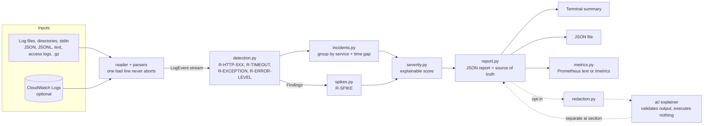

# ai-devops-incident-analyzer

[](https://github.com/<your-username>/ai-devops-incident-analyzer/actions/workflows/ci.yml)


A Python tool that reads application logs, detects operational problems, groups related errors into
**incidents**, scores their severity with **documented, explainable rules**, and writes an
**evidence-based report** (terminal summary + machine-readable JSON).

The core runs with **no API key and no third-party dependency**. An optional AI layer can explain
incidents *from the verified evidence*, but it is off by default, it can never change severity or
facts, and it never executes anything.

> **Why this design?** Detection is deterministic and testable line by line, so an on-call engineer
> can see *exactly why* something was flagged. AI is added where it is genuinely useful (interpreting
> evidence, suggesting where to look) and fenced in where it is not (deciding what is true).
> See [docs/why-deterministic-first.md](docs/why-deterministic-first.md).

## What it does

| Capability | Where |
|---|---|
| Parse JSON Lines, JSON arrays, plain text (3 shapes incl. nginx/Apache access logs), `.gz`, stdin | `reader.py`, `json_parser.py`, `text_parser.py` |
| Survive malformed lines (counted + sampled, never fatal) | `reader.py` |
| Detect HTTP 5xx, timeouts, repeated exceptions, error-level logs, error spikes | `detection.py`, `spikes.py` |
| Fingerprint messages so `timeout after 30001ms` and `...29987ms` count as one problem | `signatures.py` |
| Group findings into incidents (per service, time-gap based) | `incidents.py` |
| Explainable severity: every point has a written reason | `severity.py` |
| Terminal summary + JSON report with timestamps and log-line evidence | `report.py` |
| Structured JSON logging of the tool itself, clean exit codes | `logging_setup.py`, `cli.py` |
| Optional Prometheus metrics (file or `/metrics` endpoint) | `metrics.py` |
| Optional AI explanation, privacy-gated and validated | `ai/`, `redaction.py` |
| Optional AWS CloudWatch Logs source | `cloudwatch.py` |
| Measure detection quality against labelled data | `evaluation.py` |

## Quick start (Linux / macOS)

```bash
git clone https://github.com/<Barsha624>/ai-devops-incident-analyzer.git
cd ai-devops-incident-analyzer

python3 -m venv .venv && source .venv/bin/activate
pip install -e ".[dev]"            # runtime has zero dependencies; [dev] adds pytest, ruff, mypy

incident-analyzer analyze samples  # analyse the bundled SYNTHETIC logs
```

Or with Docker (the image bundles the synthetic samples):

```bash
docker build -t ai-devops-incident-analyzer:local .
docker run --rm ai-devops-incident-analyzer:local analyze /opt/samples --no-color
docker run --rm -v "$PWD/mylogs:/data:ro" ai-devops-incident-analyzer:local analyze /data
```

### Example output

From [`examples/terminal-summary.txt`](examples/terminal-summary.txt), generated from the synthetic samples:

```text
Incident analysis  (tool v0.1.0)
Inputs: 5 source(s) | events parsed: 2646 | malformed lines: 3
Time range: 2026-10-31T09:00:00Z -> 2026-10-31T09:44:58Z
Findings: 269 (http_5xx=177, timeout=84, exception=5, error_log=3)
Incidents: 4 (medium=1, high=1, critical=2)

[ CRITICAL ] INC-001  payments-worker: Failed to charge order <n>: connection timed out x48 (+1 other signature)
  window   : 2026-10-31T09:12:05Z -> 2026-10-31T09:23:50Z (11.7 min), 49 findings
  kinds    : timeout=48, error_log=1
  score    : 8  (why:)
             +2 base: most serious finding kind is timeout
             +2 volume: 49 findings (>= 20)
             +1 duration: lasted 11.7 min (>= 5 min)
             +2 critical: CRITICAL/FATAL log line present
             +1 variety: 2 different finding kinds
  related  : INC-002, INC-003 (overlap in time only; not proof of causation)
  evidence :
    - payments-worker.log:73 [2026-10-31T09:12:05Z]
      2026-10-31 09:12:05,414 - payments-worker - ERROR - Failed to charge order 45784: connection timed out | ...
```

The sample data tells one invented story (a database connection pool exhausted in `payments-worker`,
causing 502/504s in `checkout-api` and `web-frontend`, plus an unrelated `KeyError` bug later).
Every report is reproducible: `make examples`.

## Architecture



Details: [docs/architecture.md](docs/architecture.md).

## Usage

```bash
# Terminal summary, JSON report, or both
incident-analyzer analyze app.log
incident-analyzer analyze app.log --format json | jq '.summary'
incident-analyzer analyze logs/ --format both -o report.json

# Mixed formats and compressed logs in one run
incident-analyzer analyze nginx.log app.jsonl worker.log.gz

# Read from stdin (rotated, compressed logs, another tool's output)
zcat app.log.1.gz | incident-analyzer analyze - --default-service myapp

# Use as a CI / deploy gate: exit code 1 if a HIGH or worse incident exists
incident-analyzer analyze logs/ --fail-on high

# Tune thresholds (or use a TOML file: config/config.example.toml)
incident-analyzer analyze app.log --gap-seconds 120 --min-events 5

# Redact secrets and personal data in the report excerpts before sharing it
incident-analyzer analyze app.log --format json --redact -o shareable.json
```

Exit codes: `0` ok · `1` `--fail-on` threshold reached · `2` usage/config/input error · `130` interrupted.

## Optional features

| Feature | Command | Docs |
|---|---|---|
| Prometheus metrics | `analyze ... --metrics-file out.prom` or `serve logs/ --port 9108` | [docs/monitoring.md](docs/monitoring.md) |
| Grafana + Prometheus demo | `cd monitoring && docker compose up --build` | [docs/monitoring.md](docs/monitoring.md) |
| AI explanation | `analyze ... --ai --ai-provider offline` (no network) | [docs/ai-explanations.md](docs/ai-explanations.md) |
| AWS CloudWatch Logs | `pip install ".[aws]"` then `analyze --cloudwatch-group /aws/ecs/app --since 1h` | [docs/aws-cloudwatch.md](docs/aws-cloudwatch.md) |
| Quality measurement | `incident-analyzer evaluate evaluation/synthetic-labels.json` | [docs/evaluation.md](docs/evaluation.md) |

### About the AI feature

* **Off by default.** Enable with `--ai` or `[ai] enabled = true`. Disable *everything* with
  `INCIDENT_ANALYZER_DISABLE_AI=1`.
* **`--ai-provider offline`** uses templates, no model, no network: it demonstrates and tests the full
  pipeline without a key.
* **External providers (`anthropic`, `openai-compatible`) need explicit consent**
  (`--allow-external-ai`) and read keys from environment variables only. Run `--ai-dry-run` first to
  see exactly what would be sent. A local OpenAI-compatible server (for example Ollama) keeps data on your machine.
* **Facts vs hypotheses.** The model must separate `observed_facts` (each citing evidence ids) from
  `hypotheses` (with a confidence). Citations to evidence we did not supply are dropped; suggested
  steps that look state-changing (restart, delete, scale...) are removed.
* **Severity is never AI-controlled.** The AI output lives in its own `ai` section of the report.
* **Cost:** one request per run, bounded by `max_incidents`, `max_evidence_per_incident` and
  `max_tokens`. See [the cost section](docs/ai-explanations.md#cost).

## Configuration

Defaults are sensible; a TOML file overrides them. Unknown keys are an error, so a typo cannot
silently leave you on defaults. API keys are read **only** from the environment. See
[`config/config.example.toml`](config/config.example.toml) and [`.env.example`](.env.example).

## Project layout

```text
src/incident_analyzer/
  cli.py            argument parsing, exit codes, wiring (no analysis logic)
  reader.py         files/streams -> LogEvent (malformed-line handling)
  json_parser.py    JSON record -> LogEvent        text_parser.py  text line -> LogEvent
  timestamps.py     robust timestamp parsing        models.py       LogEvent, Level
  detection.py      the deterministic rules         signatures.py   message fingerprints
  spikes.py         error-spike rule                incidents.py    grouping into incidents
  severity.py       explainable scoring             report.py       JSON report + terminal view
  config.py         TOML config + validation        exceptions.py   one error hierarchy
  logging_setup.py  JSON/text logs of the tool      redaction.py    best-effort secret removal
  metrics.py        Prometheus text + exporter      evaluation.py   precision/recall on labels
  cloudwatch.py     optional AWS source             ai/             optional explanation layer
tests/              pytest suite, synthetic data only
samples/            synthetic logs (generated by scripts/generate_samples.py)
examples/           reports generated from the samples (scripts/make_examples.sh)
monitoring/         docker-compose + Prometheus rules + Grafana dashboard (examples)
docs/               architecture, rules, security, interview guide, ...
```

## Development

```bash
make install     # editable install with dev tools and the AWS extra
make check       # ruff lint + format check, mypy, pytest (what CI runs)
make examples    # regenerate examples/ from samples/
```

CI ([.github/workflows/ci.yml](.github/workflows/ci.yml)) runs lint, format check and mypy; tests on Python
3.11-3.13; a wheel build with an install smoke test; and a Docker build with run-time checks.

## Documentation

[Architecture](docs/architecture.md) · [Detection rules](docs/detection-rules.md) · [Grouping](docs/grouping.md) ·
[Severity](docs/severity.md) · [Log formats](docs/log-formats.md) · [Report schema](docs/report-schema.md) ·
[AI explanations](docs/ai-explanations.md) · [Security & privacy](docs/security-privacy.md) ·
[Monitoring](docs/monitoring.md) · [AWS](docs/aws-cloudwatch.md) · [Evaluation](docs/evaluation.md) ·
[Troubleshooting](docs/troubleshooting.md) · [Limitations](docs/limitations.md) · [Roadmap](docs/roadmap.md) ·
[Project walkthrough](docs/project-walkthrough.md) · [Interview guide](docs/interview-guide.md)

## Known limitations (short version)

Heuristic thresholds are not calibrated on real incident data; naive timestamps are assumed to be UTC;
the tool re-reads whole files rather than tailing them; grouping is per service and time-based, so
"possibly related" links across services show **overlap, not causation**; redaction is best-effort.
Full list: [docs/limitations.md](docs/limitations.md).

## Security

Report vulnerabilities privately (see [SECURITY.md](SECURITY.md)). Never commit `.env` files or real logs.
Privacy model: [docs/security-privacy.md](docs/security-privacy.md).

## License

MIT
