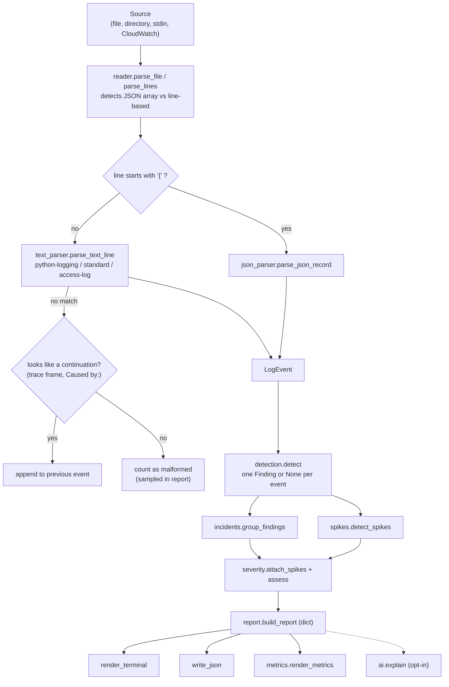

# Architecture

## The pipeline

`analyzer.analyze()` is the only function that wires the stages together. Everything before it is a
pure transformation, which is why each stage is unit-tested on its own.

## Modules and responsibilities

| Module | Responsibility | Knows nothing about |
|---|---|---|
| `models.py` | `LogEvent`, `Level` | files, rules |
| `timestamps.py` | parse many timestamp shapes to aware UTC; never raises | log formats |
| `json_parser.py`, `text_parser.py` | one record/line to `LogEvent` or `None` | files, detection |
| `reader.py` | iterate sources, collect `ParseStats`, handle malformed lines | rules |
| `signatures.py` | normalise messages and paths into fingerprints | everything else |
| `detection.py` | rules: `LogEvent` to `Finding` | grouping, severity |
| `spikes.py` | R-SPIKE over a whole run | parsing |
| `incidents.py` | group findings into `Incident`s | severity numbers |
| `severity.py` | score and explain | where incidents came from |
| `report.py` | dict report + terminal rendering | how the analysis ran |
| `metrics.py` | report dict to Prometheus text; tiny HTTP exporter | analysis internals |
| `redaction.py` | remove secrets/PII from strings | everything else |
| `ai/` | optional: payload, providers, validation | detection (it only *reads* the report) |
| `cloudwatch.py` | optional: fetch CloudWatch events as a source | rules |
| `cli.py` | arguments, exit codes, wiring | analysis logic |

## Design decisions (and why)

1. **Streaming, then keep only findings.** Events are processed one at a time; only the small set of
   *findings* is held in memory (`max_findings` caps even that). A large mostly-healthy log stays cheap.
2. **One finding per event, many rule ids.** A 504 that also says "timed out" is a single `http_5xx`
   finding listing both rules. Counts stay honest (no double-counting) and the explanation stays complete.
3. **The report dict is the single source of truth.** The terminal view, metrics and AI payload are all
   *derived from the report*, so they cannot disagree with the JSON.
4. **Malformed input is data, not an exception.** Bad lines are counted and sampled; the report says how
   much input was understood. `--strict` turns that into an error for pipelines that want it.
5. **Optional features are imported lazily.** A core run never imports `ai`, `metrics`, `cloudwatch` or
   `boto3` (this is asserted in `tests/test_cli_features.py`).
6. **No framework, no runtime dependencies.** `argparse`, `dataclasses`, `re`, `json`, `urllib`, `http.server`.
   Fewer moving parts to audit, install, or break.
7. **One exception hierarchy.** Every *expected* failure derives from `IncidentAnalyzerError`; the CLI
   catches that one class and prints a clean message. Unexpected bugs still crash loudly with a traceback.
8. **The AI layer is additive and fenced.** It reads the finished report and writes only to `report["ai"]`.
   Nothing in detection, grouping or severity can depend on it.

## Data types in one minute

* `LogEvent` (dataclass, `slots=True`): `source`, `line_no`, `raw`, `message`, `service`, `timestamp`,
  `level`, `http_status/method/path`, plus bounded stack-trace `details`.
* `Finding`: `event`, `kind` (`http_5xx | timeout | exception | error_log`), `signature`, `rules`.
* `Incident`: a list of findings for one service with derived properties (`first_seen`, `kind_counts`,
  `signature_counts`, ...) and, after scoring, `severity`, `severity_score`, `severity_reasons`.
* `SpikePeriod`: service, time range, peak, baseline, threshold.

## Where would I extend it?

* **New detection rule:** add a function + rule id in `detection.py`, add it to `detect()`, add the kind
  to `FindingKind` and `BASE_POINTS`, document it in `detection-rules.md`, test it first.
* **New log format:** add a pattern in `text_parser.py` (or aliases in `json_parser.py`) with tests.
* **New output:** consume the report dict (as `metrics.py` does); never reach back into analysis internals.
* **New AI provider:** implement `complete(system, user, max_tokens) -> Completion` and register it in
  `create_provider`.
